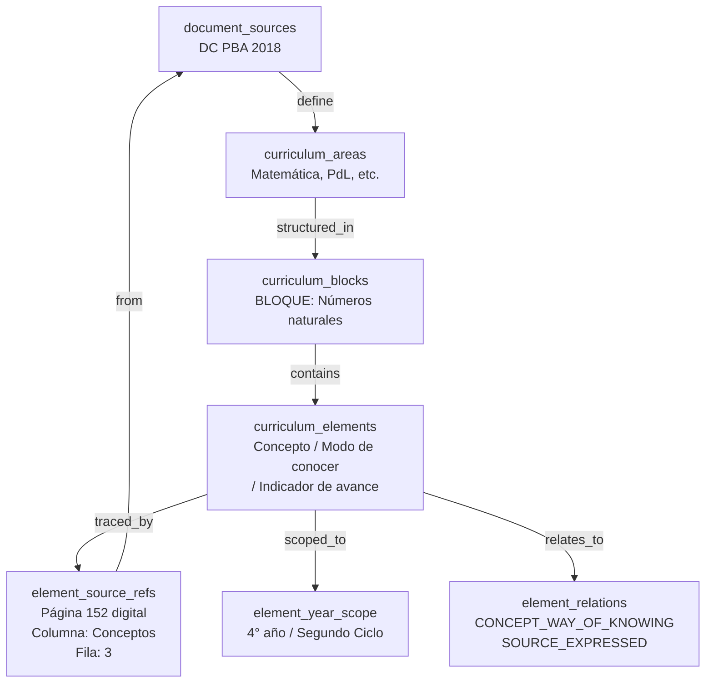
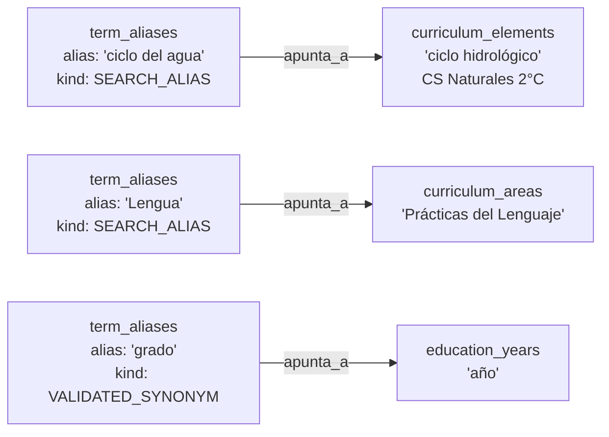
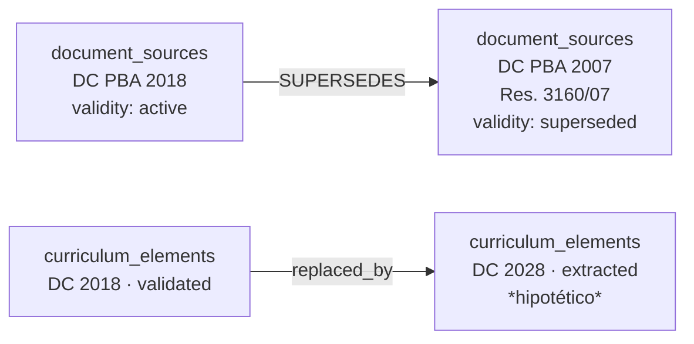

# ER_DIAGRAM.md — Diagrama Entidad-Relación
**Etapa 02.2 · Fecha: 2026-11-26**

---

## Diagrama principal (Mermaid ERD)

```mermaid
erDiagram
    %% ─── CAPA 1: FUENTES DOCUMENTALES ───

    document_sources {
        uuid id PK
        text stable_code UK
        text title
        text organism
        uuid jurisdiction_id FK
        text resolution_number
        date resolution_date
        int publication_year
        text sha256 UK
        text provenance_url
        text validity_status
        text verification_status
        text reuse_conditions
        text version_tag
        text notes
        timestamptz created_at
        timestamptz updated_at
    }

    source_relations {
        uuid id PK
        uuid source_id FK
        uuid related_source_id FK
        text relation_type
        text notes
    }

    document_sections {
        uuid id PK
        uuid source_id FK
        text section_name
        text section_kind
        int page_start_digital
        int page_end_digital
        int page_start_printed
        int page_end_printed
        text notes
    }

    %% ─── CAPA 2: ORGANIZACIÓN EDUCATIVA ───

    jurisdictions {
        uuid id PK
        text code UK
        text name
        text country_code
    }

    education_levels {
        uuid id PK
        text code UK
        text name
        uuid jurisdiction_id FK
    }

    curriculum_cycles {
        uuid id PK
        text code UK
        text name
        uuid level_id FK
        int[] year_range
    }

    education_years {
        uuid id PK
        int year_number
        text name
        uuid cycle_id FK
        text special_scope
    }

    curriculum_areas {
        uuid id PK
        text stable_code UK
        text name
        text official_name
        text area_kind
        uuid parent_area_id FK
        uuid source_id FK
        uuid level_id FK
        int page_start_digital
        int page_end_digital
        int page_start_printed
        int page_end_printed
        text table_structure_type
        text notes
    }

    curriculum_blocks {
        uuid id PK
        text stable_code UK
        text name
        uuid area_id FK
        uuid cycle_id FK
        int block_number
        int page_start_digital
        int page_end_digital
        int page_start_printed
        int page_end_printed
    }

    %% ─── CAPA 3: ELEMENTOS CURRICULARES ───

    curriculum_elements {
        uuid id PK
        text stable_id UK
        text element_type
        uuid area_id FK
        uuid block_id FK
        text year_scope
        text original_text
        text normalized_text
        text extraction_method
        text review_status
        uuid replaced_by_id FK
        text notes
        timestamptz created_at
        timestamptz updated_at
    }

    element_source_refs {
        uuid id PK
        uuid element_id FK
        uuid source_id FK
        int digital_page
        int printed_page
        text section_name
        text table_name
        int row_index
        int column_index
        text column_name
        float bbox_x0
        float bbox_y0
        float bbox_x1
        float bbox_y1
        text span_text
        text notes
    }

    element_year_scope {
        uuid element_id FK
        uuid year_id FK
        uuid cycle_id FK
        text scope_kind
    }

    %% ─── CAPA 4: RELACIONES Y TERMINOLOGÍA ───

    element_relations {
        uuid id PK
        uuid source_element_id FK
        uuid target_element_id FK
        text relation_type
        text relation_basis
        uuid source_ref_id FK
        text notes
    }

    term_aliases {
        uuid id PK
        text canonical_term
        text alias_text
        text alias_kind
        uuid scope_area_id FK
        text notes
    }

    %% ─── RELACIONES ENTRE ENTIDADES ───

    jurisdictions ||--o{ education_levels : "has"
    education_levels ||--o{ curriculum_cycles : "contains"
    curriculum_cycles ||--o{ education_years : "includes"
    education_levels ||--o{ curriculum_areas : "organizes"
    document_sources ||--o{ curriculum_areas : "defines"
    document_sources ||--o{ source_relations : "has"
    document_sources ||--o{ document_sections : "contains"
    document_sources ||--|| jurisdictions : "issued_by"
    curriculum_areas ||--o{ curriculum_areas : "parent_of"
    curriculum_areas ||--o{ curriculum_blocks : "structured_in"
    curriculum_cycles ||--o{ curriculum_blocks : "scoped_to"
    curriculum_areas ||--o{ curriculum_elements : "owns"
    curriculum_blocks ||--o{ curriculum_elements : "contains"
    curriculum_elements ||--o{ element_source_refs : "traced_by"
    curriculum_elements ||--o{ element_year_scope : "scoped_to"
    education_years ||--o{ element_year_scope : "included_in"
    curriculum_cycles ||--o{ element_year_scope : "included_in"
    document_sources ||--o{ element_source_refs : "referenced_by"
    curriculum_elements ||--o{ element_relations : "source_of"
    curriculum_elements ||--o{ element_relations : "target_of"
    element_source_refs ||--o{ element_relations : "evidenced_by"
    curriculum_areas ||--o{ term_aliases : "scoped_to"
```

---

## Diagrama simplificado — vista de trazabilidad

---

## Diagrama simplificado — alias y sinónimos

---

## Diagrama simplificado — versionado

